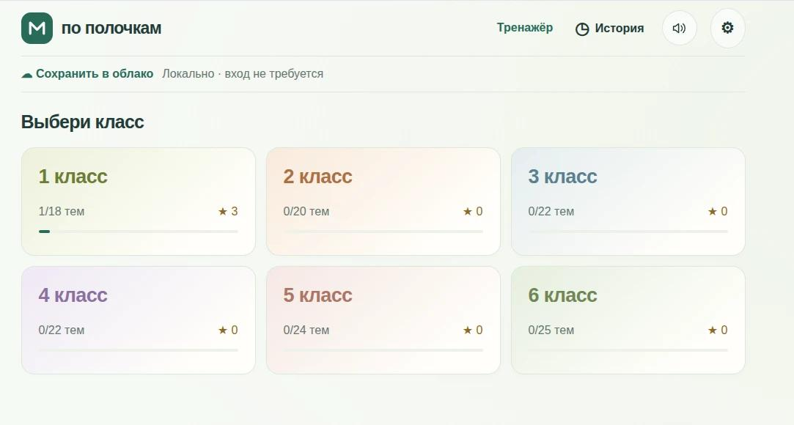

# По полочкам

Тренажёр по математике для учеников 1–6 классов. Задачи, понятные объяснения и разбор ошибок помогают заниматься самостоятельно и постепенно закреплять знания.

## Возможности

- Упражнения по темам школьной программы, усложнённые задания и экзамены.
- Проверка ответов и разбор ошибок после занятия.
- История занятий, лучшие результаты и сохранение прогресса на устройстве.
- Продолжение незавершённого занятия.
- Работа без интернета и регистрации.

## Запуск

Скачайте [index.html](index.html) и откройте его в современном браузере. Установка зависимостей и сборка не нужны: интерфейс, задания и звуки находятся в одном HTML-файле.

Прогресс сохраняется в браузере на текущем устройстве. Очистка данных сайта или браузера может удалить результаты.
